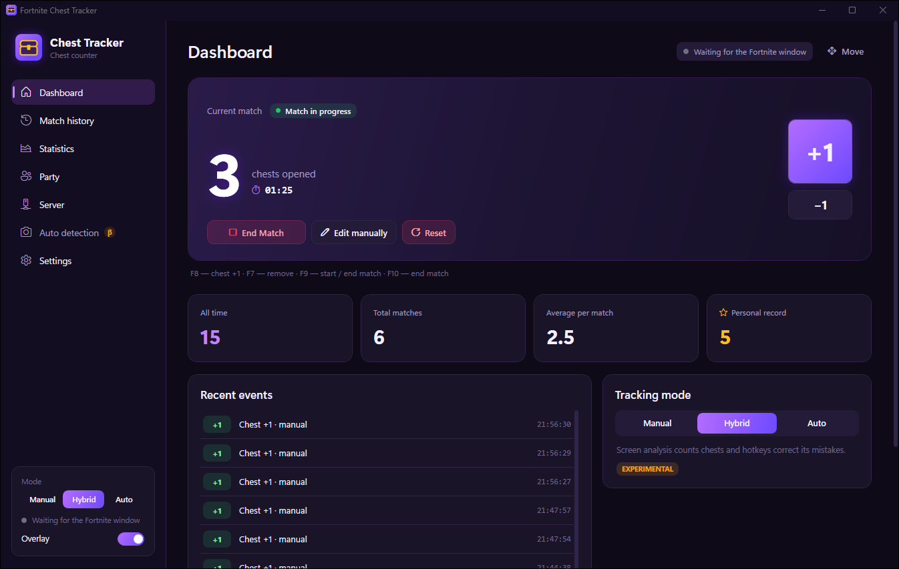
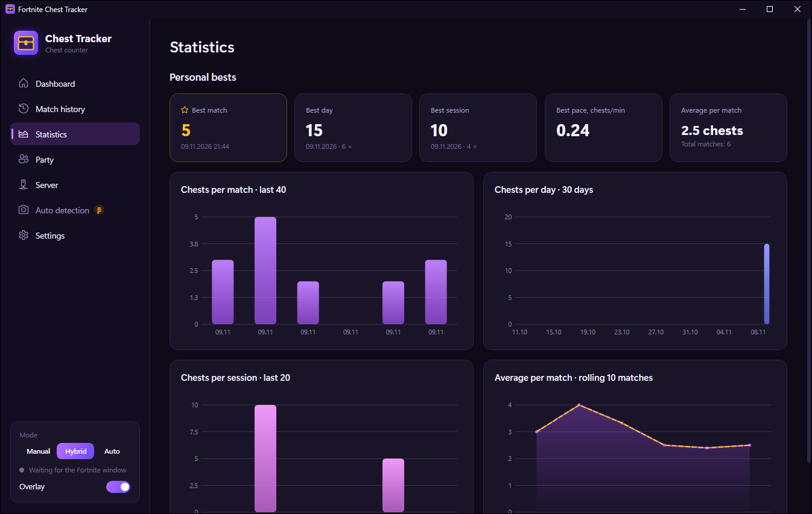
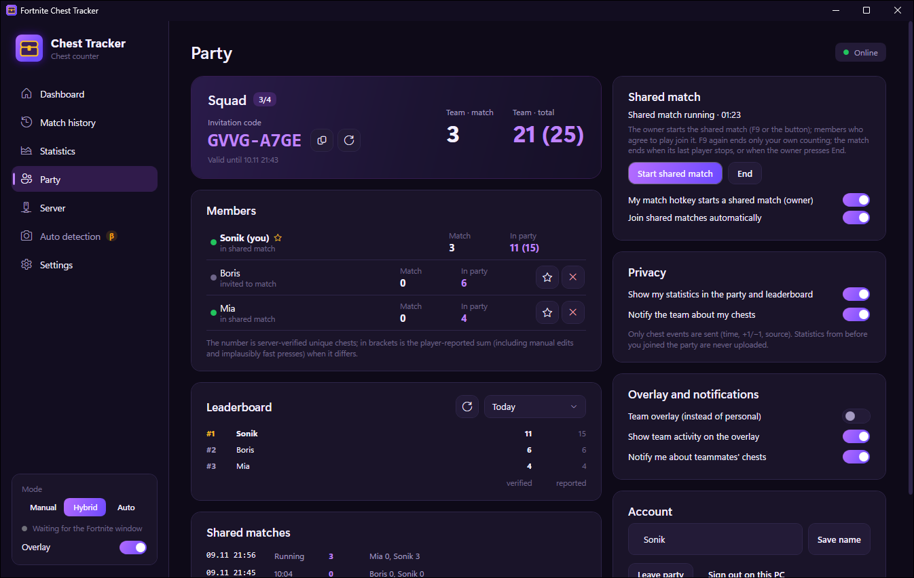
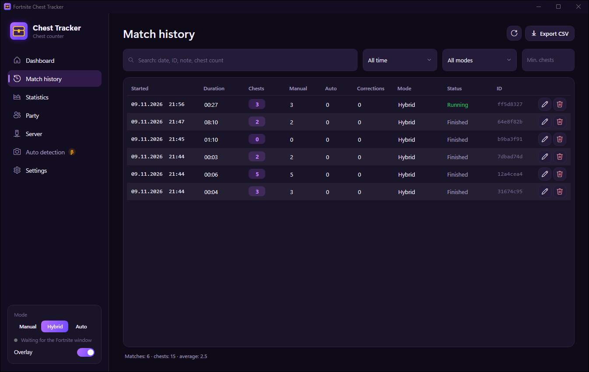
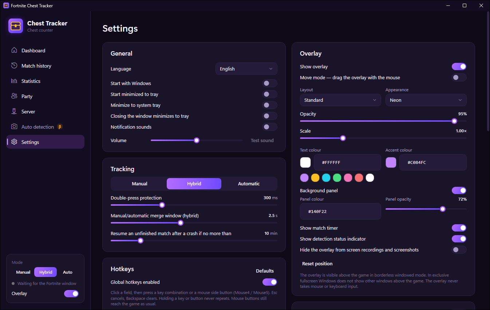
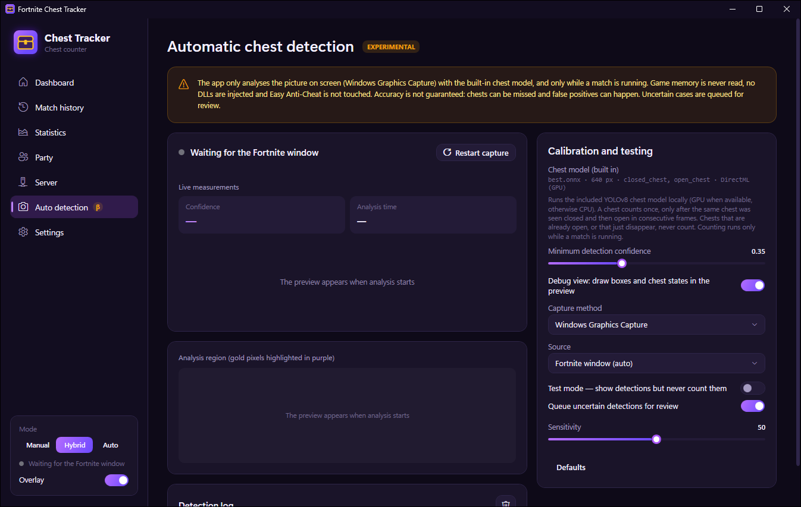
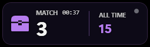

# Fortnite Chest Tracker

**A Windows application for tracking chest openings in Fortnite.**

Fortnite Chest Tracker counts the treasure chests you open, per match and all time. Press a hotkey when you drop in,
and the app counts chests for you: automatically by recognising chests on screen, by hotkey, or both. It keeps your
match history and personal records, shows a small in-game overlay, and can share live totals with your friends in a
party.

It is made for players who like to keep score of their looting: solo, or as a squad that wants to see who opened the
most chests.

> Fortnite Chest Tracker is an unofficial community project. It is not affiliated with, endorsed by or sponsored by
> Epic Games. "Fortnite" is a trademark of Epic Games, Inc.

## Download

### [⬇ Download the latest version](https://github.com/sonikx06/FNChestTracker/releases)

Open the newest release at the top of the [Releases page](https://github.com/sonikx06/FNChestTracker/releases) and,
under **Assets**, download **`FortniteChestTracker-win-x64.zip`**
([direct link for v1.2.0](https://github.com/sonikx06/FNChestTracker/releases/download/v1.2.0/FortniteChestTracker-win-x64.zip)). That is the complete app; you
do not need anything else. (The `Server` downloads are only for people who want to host a multiplayer server.)

## Screenshots

| Dashboard | Statistics |
|---|---|
|  |  |
| **Party** | **Match history** |
|  |  |
| **Settings** | **Automatic detection** |
|  |  |

In-game overlay:

*Screenshots of the real app with demo data (a local test server and a simulated teammate).*

## Features

- **Automatic chest detection** with a built-in AI model. It recognises a chest that goes from closed to open on your
  screen and counts it once, and pauses while you are spectating after being eliminated. *Beta: it works on the
  gameplay it was tested on, but it will sometimes miss chests.*
- **Manual counting** with hotkeys (F8 adds a chest, F7 removes the last one) or the on-screen +1 / −1 buttons.
- **Three tracking modes:** Manual, Automatic, and Hybrid (automatic detection plus hotkeys to correct it; a chest
  counted both ways is counted once).
- **Start / stop with one key:** F9 starts a match, F9 again ends it — for example the moment you get eliminated.
  Chests only count while a match is running.
- **Personal statistics:** all-time chests, total matches, average per match and personal records, plus charts per
  match, per day and per session.
- **Match history:** every match with its time, duration and chest count; search, filters, editing and CSV export.
- **Multiplayer parties** (needs a server, see [Multiplayer](#multiplayer)): live team totals, each member's count,
  leaderboards and shared matches.
- **Overlay:** a small always-on-top counter over the game (personal or team view), click-through, with adjustable
  size, colours and position.
- **Discord Rich Presence:** shows your match and chest count on your Discord profile.
- **Configurable hotkeys** (keyboard or the mouse side buttons Mouse4/Mouse5), **sound notifications**, English and
  Russian interface, automatic backups of your data.
- **Automatic updates:** at startup the app checks GitHub for a newer version and, if you agree, downloads, verifies
  and installs it, then restarts. Your statistics and settings are kept.

## Installation

1. Open the [Releases page](https://github.com/sonikx06/FNChestTracker/releases) and pick the newest release.
2. Download **`FortniteChestTracker-win-x64.zip`**.
3. Right-click the ZIP → **Extract All…**, and extract it to a folder of your choice (for example `Documents`).
   It contains `FortniteChestTracker.exe` and a `models` folder; keep them together.
4. Open the extracted folder and start **`FortniteChestTracker.exe`**.
   Windows may show "Windows protected your PC" because the app is new and not code-signed: click **More info** →
   **Run anyway**.
5. The interface starts in Russian: open **Настройки** (Settings) → **Язык интерфейса** (Language) → **English** if you prefer.
   Check the hotkeys under **Settings → Hotkeys** and change any that clash with your Fortnite key bindings.
6. Choose a tracking mode on the dashboard (Manual, Hybrid or Auto), press **F9** when your match starts, and play.

No installer, administrator rights or extra downloads are needed (the .NET runtime and the AI model are included).
The first start takes a few seconds longer while Windows unpacks the app's components.
To uninstall, delete the folder; your statistics are in `%LOCALAPPDATA%\FortniteChestTracker`.

**Updates.** When a new version is published, the app shows "Update available" with the changes a few seconds after
it starts. **Update now** downloads it, checks that it is the genuine package (a digital signature from this project
and a checksum), closes the app, replaces the program files, and starts the new version. If anything goes wrong, the
previous version is restored automatically. **Later** asks again at the next start. Updating from version 1.2.0 or
older must be done once by hand (download the new ZIP), because those versions had no updater.

## How to use

**Start and stop a match.** Press **F9** (or **Start Match** on the dashboard) when you drop in. Press **F9** again when
you are eliminated or the match ends: counting stops right away and the match is saved with its final count. The next
F9 starts a new match. While no match is running, chest keys and automatic detection do nothing.

**Automatic detection.** Select **Auto** or **Hybrid** mode. While a match is running, the app watches the Fortnite
window and counts a chest when it sees the same chest closed and then open. The status dot shows whether it is
analysing, paused (no match), spectating, or waiting for the Fortnite window. Unsure cases go to a review list on the
dashboard, where you count or reject them.

**Add or undo a chest manually.** Press **F8** (or **+1**) after opening a chest, **F7** (or **−1**) to remove the
last one. In Automatic mode hotkeys are disabled so they cannot double-count; use Hybrid if you want both.
You can also fix the count of the current match with **Edit manually**, or of any past match in **Match history**.

**Lifetime statistics.** The dashboard shows all-time chests, total matches, average and your record.
**Statistics** has charts and personal bests; **Match history** lists every match.

**Overlay.** Turn it on with the switch at the bottom left or **F6**. Use **Move** on the dashboard to drag it; adjust
its look under **Settings → Overlay**. Fortnite must run in **Windowed Fullscreen** (borderless) for the overlay to be
visible above the game.

**Parties.** See [Multiplayer](#multiplayer) below.

## Automatic detection

The app includes a built-in chest detection model; you do not need to download, select or configure anything. It
runs on your graphics card when possible (any DirectX 12 GPU) and otherwise on the processor.

How it decides:
- a chest counts only after the app saw it **closed** and then **open**, so looking at a chest, or a chest that is
  already open when you arrive, never counts;
- each chest counts once, even if you keep looking at it;
- nothing is counted outside a running match;
- nothing is counted while you are **spectating**: when you are eliminated and watch a teammate, the app sees Fortnite's
  "SPECTATING" banner and pauses, so your teammate's chests are not counted as yours. It resumes by itself when you are
  back in play (for example after a reboot) or in your next match. A match is never started or ended by this.

Detection quality depends on what is on screen: distance, lighting, effects, skins, chest types and graphics settings.
The model was trained on a small dataset and checked on a few minutes of real gameplay, so it **will** miss some
chests and can make mistakes. Use **Hybrid** mode if you want to fix those with hotkeys. The spectator check reads
the banner with the text recognition built into Windows; it was checked on English-language Fortnite. If your game
is in another language, or Windows has no English text recognition installed, the status stays at "Checking the game
screen" and automatic counting stays paused (use manual counting, or add English under Windows **Settings → Time &
language → Language**). If you want to help improve detection, recordings and labelled screenshots are welcome (see
[CONTRIBUTING.md](CONTRIBUTING.md)).

## Multiplayer

Parties need a **server**. There is no public server: one person in your group runs the free server program
(download `FortniteChestTracker-Server-win-x64.zip` or `-linux-x64.zip` from the release; setup guide:
[SERVER-SETUP.md](deploy/docs/SERVER-SETUP.md)) and shares its address.

1. **Connect:** on the **Server** page enter the address, press **Connect**, then continue as a guest (just a display
   name) or create an account to use the same profile on several PCs.
2. **Create a party:** on the **Party** page enter a name and the number of players, then share the invitation code
   (`XXXX-XXXX`, valid for 24 hours).
3. **Join a party:** enter the code under **Join with a code**.
4. **Shared matches:** when the party owner presses F9, a shared match starts for everyone (members join
   automatically or accept the invitation). When you are eliminated, press F9: only *your* counting stops; your
   chests stay in the shared match and your friends keep counting. The shared match ends when the last player stops,
   or when the owner presses **End**.

**How party statistics work.**
- Each member's chests and the team totals update live; teammates' chests can show a notification.
- Counts are shown as `verified (reported)` when they differ: *verified* chests passed the server's checks (for example
  not two chests within one second); *reported* also includes manual corrections.
- The party **lifetime** total includes everything the party ever counted, including the chests of former members
  who left or were removed.
- The chest sound plays only on the PC of the player who opened the chest; teammates' chests update your counters
  silently.
- In the overlay's team view: **TEAM · MATCH** is the shared match total (— when no shared match is running),
  **TEAM · TOTAL** is the party's all-time total (the same two numbers as on the Party page), and **ME · MATCH** is
  your own count in the current match.
- You can hide your counts from the party, leave, or delete your data from the server at any time. Your local
  statistics are never affected.

## System requirements

- Windows 10 (version 1903 or newer) or Windows 11, 64-bit (x64).
- About 150 MB of disk space for the app (plus about 300 MB unpacked by Windows on first start). No .NET installation needed.
- Automatic detection: a DirectX 12 graphics card is recommended (it works on the processor too, with more CPU load).
  Fortnite should run in **Windowed Fullscreen** (borderless) for screen capture and the overlay.
- Multiplayer: a server run by someone in your group (see above). Discord Rich Presence: the Discord desktop app.

## Troubleshooting

| Problem | What to try |
|---|---|
| The app does not start | Make sure you extracted the whole ZIP (don't run the exe from inside the ZIP). If Windows SmartScreen blocks it, use **More info → Run anyway**. Your antivirus may need an exception for the folder. The log is in `%LOCALAPPDATA%\FortniteChestTracker\logs\app.log`. |
| Automatic detection does not count chests | Select **Auto** or **Hybrid** mode and press **F9** to start a match: nothing is counted without a running match. Run Fortnite in **Windowed Fullscreen**. Check the **Auto detection** page: its status should say "Analysing screen". Look at the chest until it is open; chests that are already open when you arrive do not count. |
| A hotkey does not work | **Settings → Hotkeys** shows each key's status: a key used by another program shows "Used by another application"; choose a different key. Make sure the global hotkey switch is on. In Automatic mode the chest keys are disabled on purpose. |
| Multiplayer connection fails | Check the server address (including `http://` or `https://` and the port) with **Test server** on the Server page. The server's firewall must allow the port. "Incompatible version" means the app and the server need the same release. |
| The overlay does not appear | Turn it on (switch at the bottom left, or F6) and run Fortnite in **Windowed Fullscreen**: windows cannot appear above exclusive fullscreen. If it is off-screen, press **Move** on the dashboard. |
| Status "Checking the game screen — not counting yet" for a long time | The spectator check needs Windows' English text recognition. Add English in Windows **Settings → Time & language → Language** (the detection page shows a note when it is missing). It also needs Fortnite in English to recognise the banner. |
| "Update failed" | The current version keeps working; the reason is shown and logged in `%LOCALAPPDATA%\FortniteChestTracker-Update\update.log`. You can always download the new ZIP by hand. If the app folder is not writable (for example inside `Program Files`), move it to your Documents folder. |
| "The built-in chest model is missing / could not be loaded" | The `models` folder next to `FortniteChestTracker.exe` is missing or damaged. Download the ZIP again and extract it completely. Manual counting keeps working meanwhile. |

## Privacy and fair play

- **No cheating tools.** The app never reads or changes Fortnite's memory, never injects code into the game and does
  not interact with Easy Anti-Cheat. It uses normal Windows features only: global hotkeys, a screen capture of the
  Fortnite window, and an ordinary always-on-top window for the overlay.
- **Screen capture** happens only in Automatic or Hybrid mode **while a match is running**. Frames are analysed on your
  PC and immediately discarded: they are never saved or uploaded.
- **Your statistics** stay on your PC (`%LOCALAPPDATA%\FortniteChestTracker`).
- **Multiplayer (optional):** only if you connect to a server, it receives your display name, your account (a guest ID, or a
  username and password, which the server stores only as a salted hash) and your chest events after you joined a party (time, +1/−1, manual or
  automatic, match). No screenshots, game data or Epic/Fortnite account information are ever sent.
- **Discord (optional):** the app talks to the Discord app on your PC; it never asks for your Discord login.
- **Update check:** at startup the app asks GitHub's public API which releases exist (it sends only its version in
  the User-Agent). Downloads come from this repository's GitHub Releases and are installed only if their signature
  checks out.
- There is no telemetry or analytics. The only other network request is a check of the app's public image list on
  Discord's API when Discord Rich Presence is on.

## License

The source code is released under the [MIT License](LICENSE).
The built-in chest detection model was trained with Ultralytics YOLOv8 and is licensed separately under
**AGPL-3.0**; see [THIRD-PARTY-NOTICES.md](THIRD-PARTY-NOTICES.md) for it and the other bundled components.

## Disclaimer

Fortnite Chest Tracker is an unofficial, fan-made community project. It is not affiliated with, endorsed, sponsored
or approved by Epic Games, Inc. Fortnite and Epic Games are trademarks or registered trademarks of Epic Games, Inc.
The app is provided "as is", without warranty; use it at your own risk.

## For developers

Building from source, running the tests, hosting a server and the technical details are in
[CONTRIBUTING.md](CONTRIBUTING.md).
